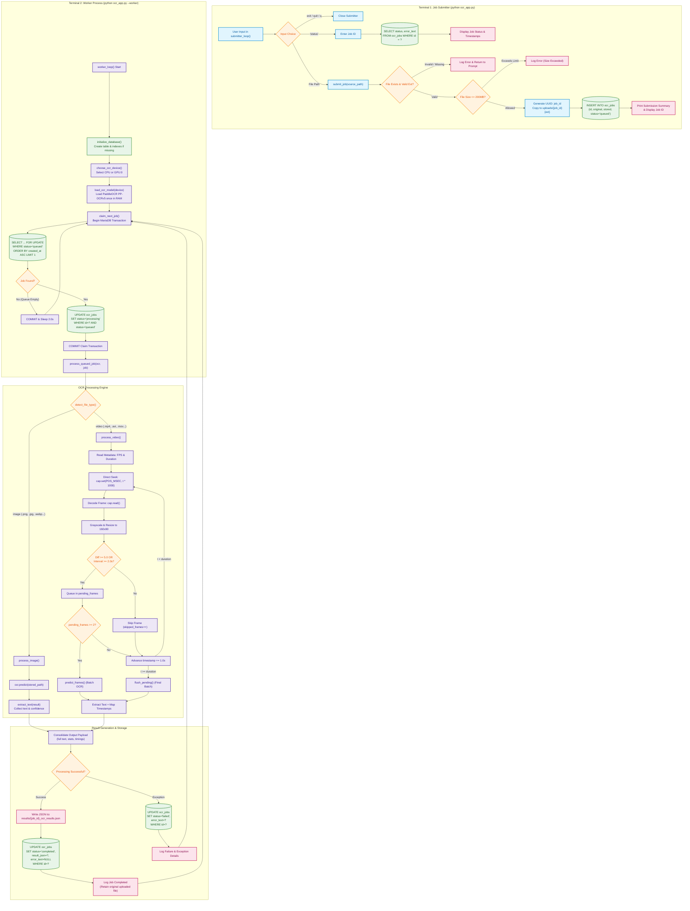
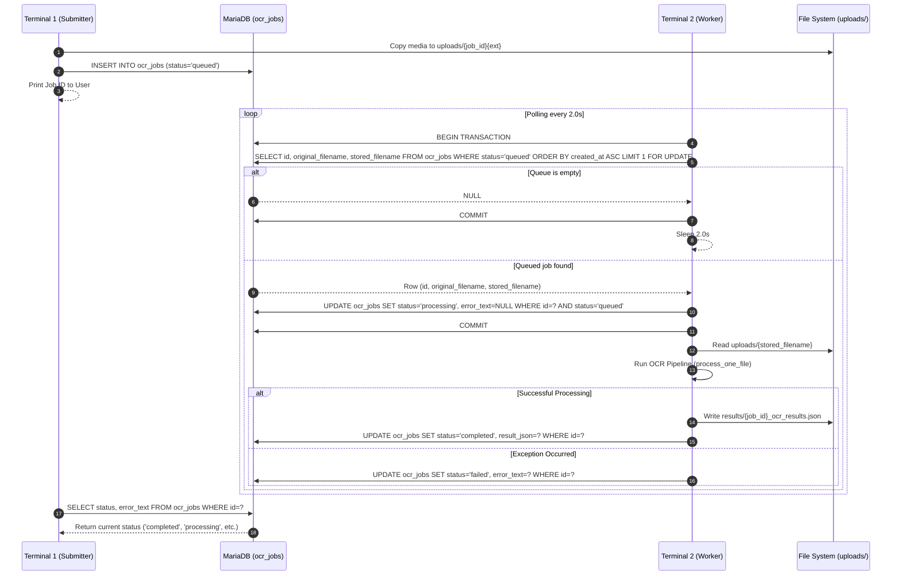
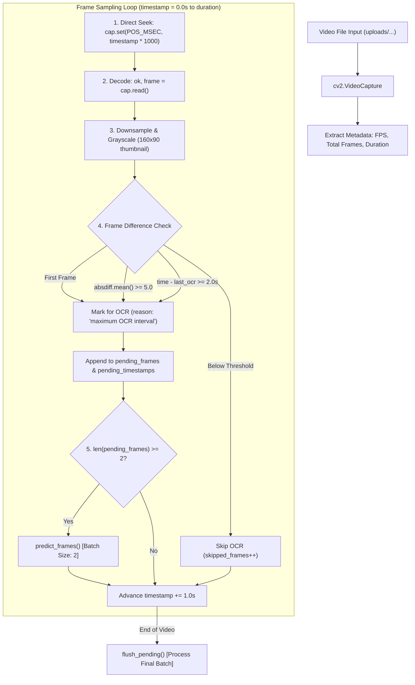
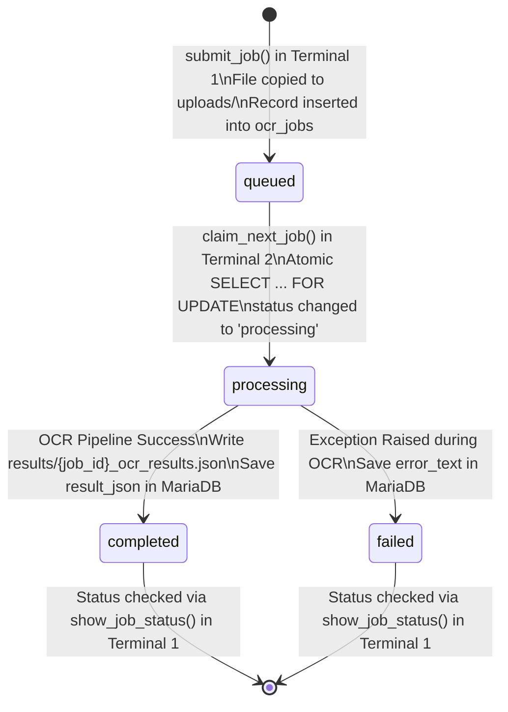

# Multilingual Social Media OCR: End-to-End Data Flow Architecture

This document provides a comprehensive analysis of how data flows through the application pipeline in [`ocr_app.py`](file:///c:/Users/HP/social-media-ocr/ocr_app.py) from initial media ingestion and MariaDB queue persistence to optimized batch OCR execution, JSON result generation, and database updates.

---

## 1. Architecture Overview (Mode A: Decoupled CLI Submitter & Worker)

The application in [`ocr_app.py`](file:///c:/Users/HP/social-media-ocr/ocr_app.py) operates as a decoupled producer-consumer system across two terminal processes connected through a centralized MariaDB database. The legacy Web API (Mode B) has been removed in favor of this direct, reliable queue architecture:

```
                            ┌──────────────────────────────┐
                            │      Input Media File        │
                            │   (Image: JPG, PNG, WEBP...) │
                            │   (Video: MP4, MOV, MKV...)  │
                            └──────────────┬───────────────┘
                                           │
                                           ▼
┌────────────────────────────────────────────────────────────────────────────────────────┐
│ TERMINAL 1: JOB SUBMITTER PROCESS (`python ocr_app.py`)                                │
│                                                                                        │
│   submitter_loop() ──► Prompt: image/video path, status, or exit                       │
│                              │                                                         │
│                              ├───────────────────────────────┐                         │
│                              ▼                               ▼                         │
│                     [Enter File Path]                 [Enter 'status']                 │
│                              │                               │                         │
│                        submit_job()                  show_job_status()                 │
│                              │                               │                         │
│         - Validate extension & size (<=200MB)                │                         │
│         - Generate UUID v4: job_id                           │                         │
│         - Copy file: shutil.copy2 ──► uploads/{job_id}{ext}  │                         │
│                              │                               │                         │
│                              ▼                               │                         │
│                     MariaDB: ocr_jobs                        │                         │
│                     INSERT (status='queued')                 │                         │
│                              │                               │                         │
└──────────────────────────────┼───────────────────────────────┼─────────────────────────┘
                               │                               │
                               ▼                               │
┌──────────────────────────────────────────────────────────────┼─────────────────────────┐
│ MARIADB DATABASE (`ocr_jobs` Table)                          │                         │
│                                                              │                         │
│  - Storage: id, original_filename, stored_filename, status,  │ SELECT status, error    │
│            result_json, error_text, created_at, updated_at   │ WHERE id = ?            │
│  - Statuses: 'queued' ──► 'processing' ──► 'completed'/'failed'                        │
└──────────────────────────────┬───────────────────────────────┼─────────────────────────┘
                               │ (Row-level lock: FOR UPDATE)  │
                               ▼                               ▼
┌────────────────────────────────────────────────────────────────────────────────────────┐
│ TERMINAL 2: OCR WORKER PROCESS (`python ocr_app.py --worker`)                          │
│                                                                                        │
│   1. initialize_database(): Ensure ocr_jobs table & indexes exist                      │
│   2. choose_ocr_device(): Interactive CPU / GPU selection                              │
│   3. load_ocr_model(): PaddleOCR PP-OCRv5 loaded ONCE into persistent memory           │
│   4. worker_loop(): Continuous polling loop (every 2.0s)                               │
│            │                                                                           │
│            ▼                                                                           │
│      claim_next_job(): Atomically locks oldest queued job (status ──► 'processing')     │
│            │                                                                           │
│            ▼                                                                           │
│      process_queued_job(): Reads uploads/{stored_filename}                             │
│            │                                                                           │
│            ▼                                                                           │
│      process_one_file(): Dispatches by detected file type                              │
│            │                                                                           │
│            ├──────────────────────────────┐                                            │
│            ▼                              ▼                                            │
│   ┌────────────────┐            ┌───────────────────────────────────┐                  │
│   │ process_image  │            │          process_video            │                  │
│   │                │            │ - Millisecond Timestamp Seeking   │                  │
│   │ PaddleOCR      │            │ - Downsampled 160x90 Frame Diff   │                  │
│   │ .predict()     │            │ - Batch Inference (Size: 2)       │                  │
│   │                │            │ - Single-frame Fallback           │                  │
│   └────────┬───────┘            └─────────────────┬─────────────────┘                  │
│            │                                      │                                    │
│            └──────────────────────┬───────────────┘                                    │
│                                   ▼                                                    │
│                        extract_text(): Parse text & confidence                         │
│                                   │                                                    │
│                                   ▼                                                    │
│                        Consolidate complete text & timing statistics                   │
│                                   │                                                    │
│            ┌──────────────────────┴──────────────────────┐                             │
│            ▼                                             ▼                             │
│   Disk Output:                                  MariaDB Update:                        │
│   results/{job_id}_ocr_results.json             UPDATE ocr_jobs                        │
│                                                 SET status='completed',                │
│                                                     result_json=?, error_text=NULL     │
│                                                 WHERE id = ?                           │
└────────────────────────────────────────────────────────────────────────────────────────┘
```

1. **Terminal 1: Job Submitter Process (`python ocr_app.py`)**:
   - Interactive prompt accepting media file paths (`.jpg`, `.png`, `.mp4`, etc.) or commands (`status`, `exit`).
   - Validates file existence, format, and size limit (default 200 MB).
   - Generates a UUID v4 `job_id`, copies the file into `uploads/{job_id}{ext}`, and inserts a record into MariaDB with `status = 'queued'`.
   - Allows querying the live status of any job without blocking the worker.

2. **Terminal 2: Background OCR Worker Process (`python ocr_app.py --worker`)**:
   - Initializes database tables and indexes automatically.
   - Interactively allocates computing device (CPU or GPU:0) and loads the `PP-OCRv5` neural network into RAM **once**.
   - Polls MariaDB every 2 seconds (`WORKER_POLL_SECONDS`), atomically claims queued jobs using `SELECT ... FOR UPDATE`, and updates status to `processing`.
   - Executes image or video OCR pipeline with timestamp-based seeking, 160×90 frame difference filtering, and batched inference.
   - Serializes formatted JSON results to `results/{job_id}_ocr_results.json` and updates MariaDB status to `completed` (or `failed`).

---

## 2. High-Level Mermaid Flow Diagram



---

## 3. Step-by-Step Flow Explanation

### Step 1: Environment & Database Initialization

When launching either the Submitter or Worker process:
- **UTF-8 Output**: Sets `sys.stdout` and `sys.stderr` to UTF-8 encoding to guarantee proper rendering of Devanagari script (Hindi and Marathi) on Windows.
- **Environment Flags**: Sets `os.environ["PADDLE_PDX_ENABLE_MKLDNN_BYDEFAULT"] = "False"` prior to importing PaddleOCR to avoid oneDNN attribute conversion incompatibilities on CPU.
- **Directory Creation**: Automatically verifies and creates `uploads/` and `results/` in the application root directory.
- **Database Schema**: [`initialize_database()`](file:///c:/Users/HP/social-media-ocr/ocr_app.py#L136-L190) creates the `ocr_jobs` table and composite index `(status, created_at)` if not already present:
  ```sql
  CREATE TABLE IF NOT EXISTS ocr_jobs (
      id CHAR(36) PRIMARY KEY,
      original_filename VARCHAR(255) NOT NULL,
      stored_filename VARCHAR(255) NOT NULL,
      status ENUM('queued', 'processing', 'completed', 'failed') NOT NULL DEFAULT 'queued',
      result_json LONGTEXT NULL,
      error_text TEXT NULL,
      created_at TIMESTAMP NOT NULL DEFAULT CURRENT_TIMESTAMP,
      updated_at TIMESTAMP NOT NULL DEFAULT CURRENT_TIMESTAMP ON UPDATE CURRENT_TIMESTAMP,
      INDEX idx_status_created (status, created_at)
  ) ENGINE=InnoDB DEFAULT CHARSET=utf8mb4 COLLATE=utf8mb4_unicode_ci;
  ```

---

### Step 2: Terminal 1 — Job Ingestion & Submission (`submitter_loop`)

Function: [`submitter_loop()`](file:///c:/Users/HP/social-media-ocr/ocr_app.py#L1124-L1178) and [`submit_job()`](file:///c:/Users/HP/social-media-ocr/ocr_app.py#L670-L763).

1. **User Interaction**:
   - The user runs `python ocr_app.py` in Terminal 1.
   - Enters an image or video file path (e.g., `Hindi.jpg` or `C:\path\video.mp4`), `status`, or `exit`.
2. **File Validation**:
   - Strips leading/trailing quotes and spaces, expanding `~` via `Path.expanduser()`.
   - Confirms file presence via `source_path.is_file()`.
   - Validates extension via [`detect_file_type()`](file:///c:/Users/HP/social-media-ocr/ocr_app.py#L597-L607):
     - `IMAGE_EXTENSIONS`: `.png`, `.jpg`, `.jpeg`, `.bmp`, `.webp`, `.tif`, `.tiff`
     - `VIDEO_EXTENSIONS`: `.mp4`, `.avi`, `.mov`, `.mkv`, `.webm`, `.m4v`
   - Validates file size against `MAX_UPLOAD_BYTES` (default 200 MB, configurable via environment variable `OCR_MAX_UPLOAD_BYTES`).
3. **Safe File Staging**:
   - Generates a UUID v4 string: `job_id = str(uuid.uuid4())`.
   - Constructs a unique destination filename to avoid overwrites: `stored_filename = f"{job_id}{source_path.suffix.lower()}"`.
   - Copies the file using `shutil.copy2(source_path, UPLOAD_DIR / stored_filename)`.
4. **MariaDB Enqueueing**:
   - Inserts the job with `status = 'queued'`:
     ```sql
     INSERT INTO ocr_jobs (id, original_filename, stored_filename, status)
     VALUES (?, ?, ?, 'queued');
     ```
   - Prints confirmation containing the `job_id`, file name, detected type, and timing.
   - If database insertion fails, removes the copied file from `uploads/` to maintain filesystem hygiene.
5. **Status Checking ([`show_job_status`](file:///c:/Users/HP/social-media-ocr/ocr_app.py#L770-L815))**:
   - If the user types `status` followed by a `job_id`:
     ```sql
     SELECT id, original_filename, status, error_text, created_at, updated_at
     FROM ocr_jobs WHERE id = ?;
     ```
   - Displays the current processing state in the terminal without interrupting the worker.

---

### Step 3: Terminal 2 — Worker Startup & Device Allocation (`worker_loop`)

Function: [`choose_ocr_device()`](file:///c:/Users/HP/social-media-ocr/ocr_app.py#L87-L124) and [`load_ocr_model()`](file:///c:/Users/HP/social-media-ocr/ocr_app.py#L193-L216).

1. **Hardware Verification**:
   - Prompts the user to select `1. CPU` or `2. GPU`.
   - If GPU is chosen, verifies CUDA support via `paddle.is_compiled_with_cuda()` and `paddle.device.cuda.device_count() >= 1`.
   - Allocates `device="gpu:0"` if confirmed, or falls back gracefully to CPU.
2. **Model Instantiation**:
   - `lang="hi"`: Loads the Devanagari recognition dictionary (covers Hindi, Marathi, and English characters).
   - `ocr_version="PP-OCRv5"`: Mobile recognition and server detection neural architectures.
   - `use_doc_unwarping=False`: **Crucial Optimization** — prevents loading heavy 3D book unwarping models (`UVDoc`), reducing startup latency from ~87s to <1s.
   - `use_doc_orientation_classify=False`: Skips orientation classifier for digital social media.
   - `cpu_threads=4` and `enable_mkldnn=False` (when running on CPU).
3. **Persistent Model Reuse**:
   - PaddleOCR is instantiated **once** upon worker launch and kept resident in GPU/CPU RAM, eliminating cold-start latency for all subsequent jobs.

---

### Step 4: Atomic Job Claiming Sequence (`claim_next_job`)

Function: [`claim_next_job()`](file:///c:/Users/HP/social-media-ocr/ocr_app.py#L822-L897).

To prevent race conditions and ensure only one worker claims a job, claiming is executed inside an atomic transaction using MariaDB row-level locking:



---

### Step 5: Branch A — Single Image OCR Execution

Function: [`process_image()`](file:///c:/Users/HP/social-media-ocr/ocr_app.py#L351-L365).

1. Reads image file path from disk: `stored_path = UPLOAD_DIR / job["stored_filename"]`.
2. Passes image path to `ocr.predict(str(file_path))`.
3. Calls [`extract_text()`](file:///c:/Users/HP/social-media-ocr/ocr_app.py#L222-L257) on prediction results:
   - Traverses dictionary / JSON response.
   - Extracts `rec_texts` (detected character strings) and `rec_scores` (confidence probabilities).
   - Filters out empty or whitespace-only records.
   - Formats records into structured items:
     ```json
     {
       "text": "नमस्ते दुनिया",
       "confidence": 0.9842
     }
     ```
4. Measures and logs inference time via `time.perf_counter()`.

---

### Step 6: Branch B — Optimized Video OCR Execution

Function: [`process_video()`](file:///c:/Users/HP/social-media-ocr/ocr_app.py#L371-L591).

Video processing utilizes a multi-stage optimization pipeline to eliminate redundant frame processing:



#### Optimization Techniques:

1. **Millisecond Timestamp Seeking**:
   - Jumps directly to sample intervals using `cap.set(cv2.CAP_PROP_POS_MSEC, timestamp * 1000)`.
   - Bypasses decoding 29 out of every 30 frames in a 30 FPS video, saving substantial CPU decoding overhead.
2. **Grayscale Downsampling & Difference Calculation**:
   - The sampled frame is converted to grayscale and downsampled to $160 \times 90$:
     ```python
     gray_small = cv2.resize(gray, (COMPARE_WIDTH, COMPARE_HEIGHT), interpolation=cv2.INTER_AREA)
     ```
   - Running `cv2.absdiff(previous_gray, gray_small).mean()` on a $160 \times 90$ matrix takes less than **0.5 milliseconds**.
3. **Dual-Trigger OCR Filter**:
   - Frame difference threshold: `FRAME_DIFF_THRESHOLD = 5.0`.
   - Max OCR interval safeguard: `MAX_OCR_INTERVAL = 2.0` seconds (ensures persistent titles or slow background transitions are periodically re-scanned).
   - Visually identical frames are skipped entirely, saving ~9–10 seconds of neural network inference per static frame.
4. **Batched Inference with Fallback ([`predict_frames`](file:///c:/Users/HP/social-media-ocr/ocr_app.py#L263-L346))**:
   - Accumulates candidate frames in batches of `OCR_BATCH_SIZE = 2`.
   - Attempts batched inference: `ocr.predict(frames)`.
   - If batch prediction fails, automatically falls back to sequential single-frame prediction without crashing the worker.
5. **Timestamp Mapping**:
   - Maps each recognized text item to its corresponding video timestamp:
     ```json
     {
       "text": "Breaking News",
       "confidence": 0.951,
       "timestamp_seconds": 2.0
     }
     ```

---

### Step 7: Aggregation, Output Persistence & MariaDB Update

Function: [`process_one_file()`](file:///c:/Users/HP/social-media-ocr/ocr_app.py#L614-L664) and [`process_queued_job()`](file:///c:/Users/HP/social-media-ocr/ocr_app.py#L946-L1045).

1. **Text Assembly**:
   - Joins all non-empty recognized text lines with newlines:
     ```python
     complete_text = "\n".join(item["text"] for item in extracted if item.get("text", "").strip())
     ```
2. **Result Packaging**:
   - Assembles a structured output dictionary:
     ```json
     {
       "job_id": "1bce66f6-0be5-4889-bf0a-a23739a695b3",
       "original_filename": "sample_video.mp4",
       "input_file": "1bce66f6-0be5-4889-bf0a-a23739a695b3.mp4",
       "input_type": "video",
       "languages": ["English", "Hindi", "Marathi"],
       "model_load_time_seconds": 0.521,
       "model_reused": true,
       "processing_time_seconds": 3.842,
       "video_statistics": {
         "video_duration_seconds": 7.0,
         "video_fps": 30.0,
         "sampled_frames": 8,
         "ocr_processed_frames": 3,
         "skipped_frames": 5,
         "batch_calls": 1,
         "single_frame_calls": 1,
         "batch_fallbacks": 0,
         "detailed_timing_seconds": {
           "video_seeking": 0.041,
           "frame_decoding": 0.035,
           "preprocessing": 0.004,
           "frame_comparison": 0.003,
           "ocr_inference": 3.712,
           "result_handling": 0.047
         }
       },
       "extracted_text": [
         {
           "text": "ताज़ा खबर",
           "confidence": 0.963,
           "timestamp_seconds": 0.0
         }
       ],
       "complete_extracted_text": "ताज़ा खबर"
     }
     ```
3. **Dual Persistence**:
   - **Disk Export**: Serializes formatted JSON to `results/{job_id}_ocr_results.json`.
   - **Database Storage**: Updates MariaDB:
     ```sql
     UPDATE ocr_jobs
     SET status = 'completed',
         result_json = ?,
         error_text = NULL
     WHERE id = ?;
     ```
4. **Error Handling**:
   - If an exception occurs at any point during OCR, catches the error and marks the job as failed:
     ```sql
     UPDATE ocr_jobs
     SET status = 'failed',
         result_json = NULL,
         error_text = ?
     WHERE id = ?;
     ```
5. **Data Retention**:
   - The stored media in `uploads/{stored_filename}` is intentionally preserved for reference or re-runs, and can be purged manually when needed.

---

## 4. Database State Machine



---

## 5. Performance Instrumentation & Telemetry

[`ocr_app.py`](file:///c:/Users/HP/social-media-ocr/ocr_app.py) incorporates lightweight, zero-dependency telemetry:

- **Centralized Timestamp Logging**: The [`log()`](file:///c:/Users/HP/social-media-ocr/ocr_app.py#L78-L80) helper outputs timestamps in `[YYYY-MM-DD HH:MM:SS]` format directly to `sys.stdout` with immediate flushing (`flush=True`), avoiding unbuffered console delays.
- **Microsecond Wall-Clock Profiling**: Uses `time.perf_counter()` across every critical section:
  - File copying latency (`shutil.copy2`)
  - MariaDB query and commit durations
  - PaddleOCR inference latency
  - Sub-millisecond video breakdown: seeking (`cap.set`), decoding (`cap.read`), preprocessing, comparison, and result serialization.
- **Session Job Tracking**: The worker keeps a running tally of jobs handled during the active session and logs completion timestamps on each cycle.
